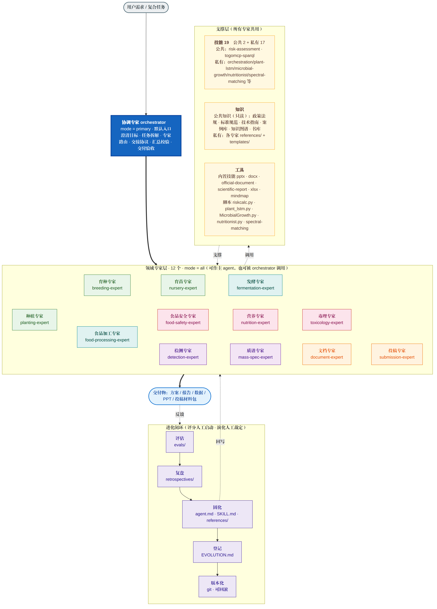
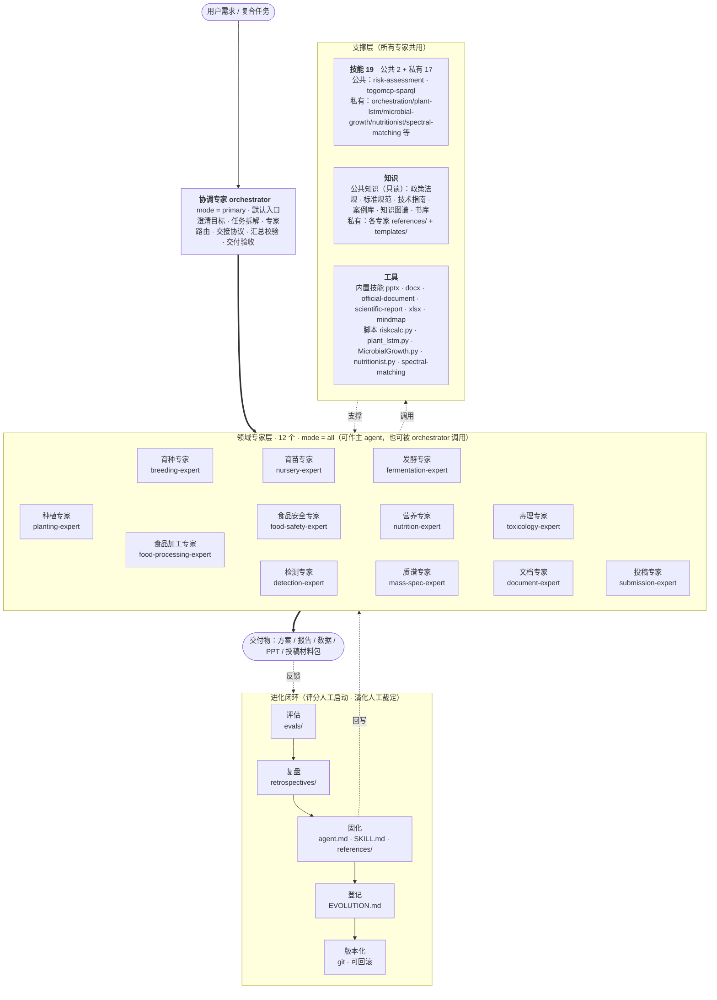
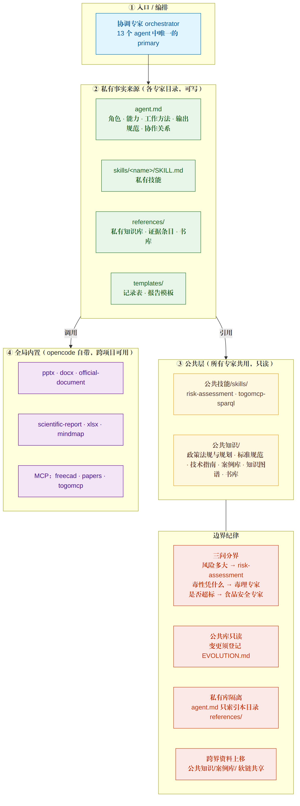
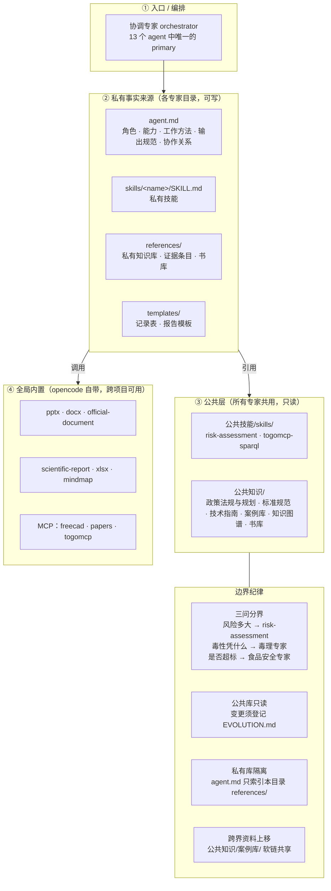
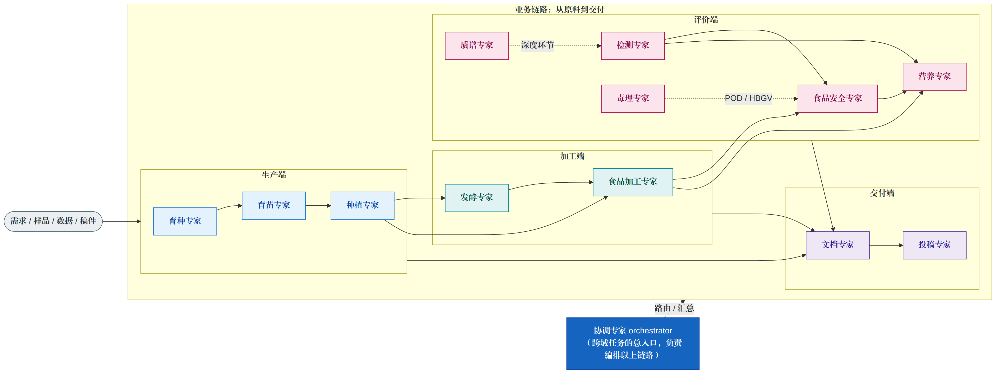
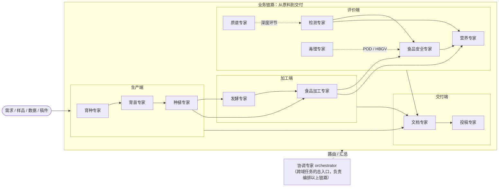
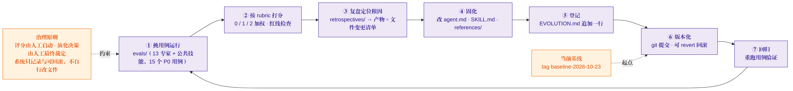
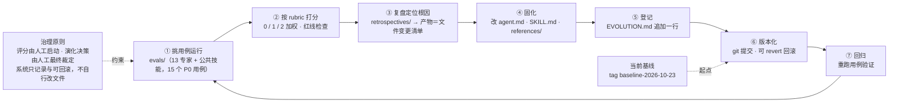
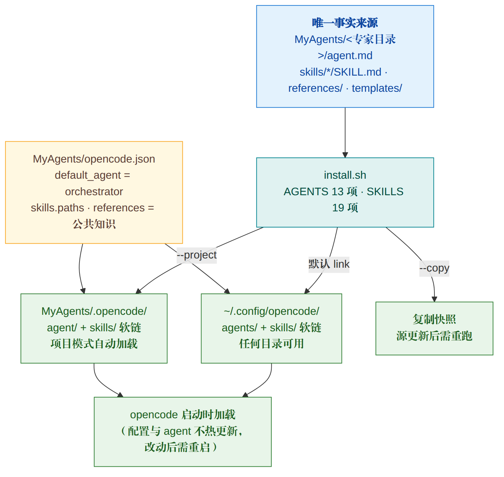
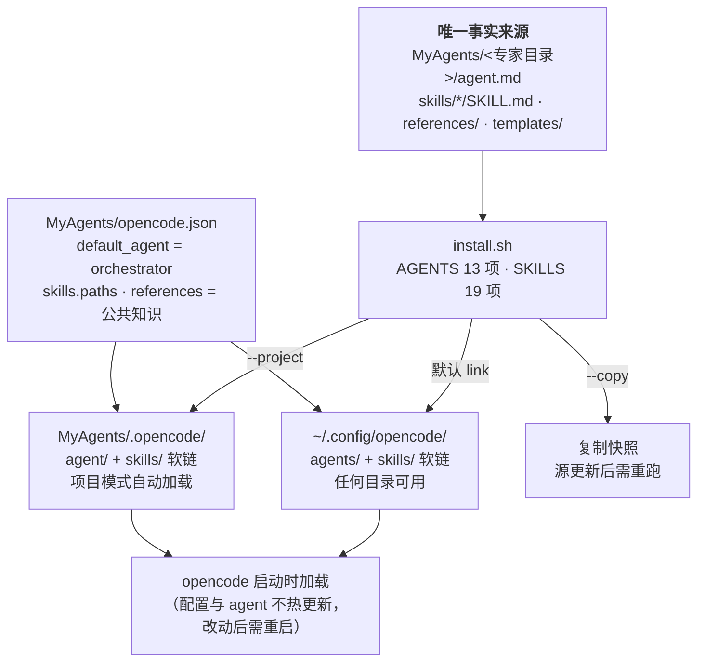

# MyAgents 专家 Agent 体系图

> 对象：`/home/caiq/MyAgents` —— 面向「健康食品与现代农业」的 opencode 领域专家 Agent 库
> 基线：`2026-10-23`（git tag `baseline-2026-10-23`）｜模型：继承全局默认 `paratera/DeepSeek-V4-Flash`
> 事实来源：各专家 `agent.md`、`skills/*/SKILL.md`、`install.sh`、`opencode.json`、`EVOLUTION.md`、`evals/registry.md`

本目录含 5 张图（PNG / SVG 双份，矢量可放任意大）与源文件 `mmd/*.mmd`：

| 图 | 内容 | 文件 |
|---|---|---|
| ① 体系总览 | 入口层 → 领域专家层 → 支撑层 → 交付物 + 进化闭环 | `01-总览.png / .svg` |
| ② 分层与边界 | 私有事实来源 / 公共只读层 / 全局内置 / 边界纪律 | `02-分层.png / .svg` |
| ③ 业务协作流 | 生产端 → 加工端 → 评价端 → 交付端的真实依赖链 | `03-协作流.png / .svg` |
| ④ 进化闭环 | 评估 → 复盘 → 固化 → 登记 → 版本化 → 回归 | `04-进化闭环.png / .svg` |
| ⑤ 部署加载机制 | `install.sh` 三种模式与启动加载 | `05-部署机制.png / .svg` |

**另外两件成品**

| 成品 | 说明 | 文件 |
|---|---|---|
| 全集 PNG | 5 张图纵向拼合（含页头 / 小标题 / 说明 / 页脚），单张查看或贴文档用 | `MyAgents-体系图-全集.png`（1776×10467） |
| 演示 PPT | **长三院简洁模板样式**（深蓝 #1A3C6E 标题带 + 蓝色强调线，封面/分隔页满版深蓝，页脚「浙江清华长三角研究院」+ 页码），16:9、**19 页**：封面 · 目录 · 体系速览 · 5 组［分隔页 + 图页］· 专家清单 2 页 · 公共层与边界 · 关键统计与维护 · 结尾 | `MyAgents-体系图.pptx` |

生成脚本：`compose_all.py`（拼全集 PNG，依赖 Pillow）、`make_ppt.py`（生成 PPT，依赖 python-pptx + Pillow）。

**PPT 版式来源**：样式取自文档专家 `文档专家/templates/ppt-长三院简洁模板-template.md` 与同目录 `generate_pptx.py`（原 `.pot` 为 WPS 创建的 97-2003 格式，`python-pptx` 无法直接打开，故按其视觉规范重绘）：

| 元素 | 规范 |
|---|---|
| 主色 | 深蓝 `#1A3C6E`（标题带 / 封面 / 分隔页 / 表头） |
| 强调色 | 蓝 `#2E75B6`（色条、项目符、页码装饰） |
| 正文 / 底纹 | `#333333` / `#F2F5FA` |
| 字体 | 中文 微软雅黑，西文 Arial（已同时写入 `a:latin` `a:ea` `a:cs`） |
| 版式 | 封面满版深蓝；分隔页大号色块序号；内容页顶部标题带 + 页脚研究院名 + `n/N` 页码；表格 No-Style-No-Grid + 深蓝表头 |

---

## ① 体系总览





**读法**：13 个 agent 中只有 `orchestrator` 是 `primary`（默认入口）；其余 12 个是 `mode: all`，既可被手动选为主 agent 单干，也可被 orchestrator 当子 agent 调用。专家不直接互相读对方私有库，跨域资料统一上移到公共层。

---

## ② 分层与边界





---

## ③ 业务协作流（跨专家真实依赖链）





**三条支撑线**（易混，图里用虚线标出）：

- **质谱专家 → 检测专家**：检测专家管全局标准/前处理/质量体系；质谱专家管质谱深度环节（电离与分析器选型、碎裂规律、MRM/HRMS、未知物鉴定）。
- **毒理专家 → 食品安全专家**：毒理专家产出**毒性凭什么**（POD / HBGV / 证据权重）；食品安全专家做**是否超标**（限量比对、合规判定、HACCP）。
- **风险评估（公共技能）** 贯穿两者：只做**风险多大**（暴露、HQ/MOE/ILCR、概率评估、排序），三者互不替代。

---

## ④ 进化闭环





规则：**失败一个用例，就应产出一条固化动作**。首次全量评分为 15/15 通过（自动预评，最终裁定留人工）。

---

## ⑤ 部署与加载机制





改 `agent.md` / `SKILL.md` 即改行为——项目与全局软链自动生效，**但要重启 opencode**。

---

## 附录 A　专家 ↔ 技能 ↔ 知识 映射

`★` = 可执行技能（带脚本，可直接跑）。

| # | 专家 | agent id | mode | temp | 私有技能 | 私有知识库 `references/` |
|---|---|---|---|---|---|---|
| 1 | 协调专家 | `orchestrator` | **primary** | 0.2 | `orchestration` | 编排模式与路由、跨专家工作流与场景（6 个端到端）、汇总质检与输出规范 |
| 2 | 种植专家 | `planting-expert` | all | 0.3 | `planting-knowledge`、`plant-lstm` ★ | 栽培/粮油/园艺/药用食用菌/水稻/标准 ＋ 证据条目 61+47 条 ＋ 书库 48 册 |
| 3 | 育种专家 | `breeding-expert` | all | 0.25 | `breeding-knowledge` | 种质/途径/分子/抗性品质/审定制种/标准 ＋ 证据条目 64 条 ＋ 书库 16 册 ＋ 文献清单 |
| 4 | 育苗专家 | `nursery-expert` | all | 0.3 | `nursery-knowledge` | 种子/基质/嫁接扦插/组培/工厂化/质量标准 ＋ 证据条目 60 条 ＋ 书库 14 册 |
| 5 | 发酵专家 | `fermentation-expert` | all | 0.3 | `fermentation-knowledge`、`microbial-growth` ★ | 工艺与参数/菌种/培养基/动力学/下游/标准 ＋ 证据条目 46 条 ＋ 书库 34 册 |
| 6 | 食品加工专家 | `food-processing-expert` | all | 0.3 | `food-processing` | 单元操作/配方/货架期/中试/标准 ＋ 证据条目 51 条 ＋ 书库 118 册/篇 |
| 7 | 食品安全专家 | `food-safety-expert` | all | 0.2 | `food-safety` | 标准法规/化学危害/生物危害/评估方法/检测监测与 HACCP/国际机构 ＋ 风险排序案例 |
| 8 | 营养专家 | `nutrition-expert` | all | 0.3 | `nutrition`、`nutritionist` ★ | DRIs/膳食成分/配餐/标签/人群运动/标准 ＋ 证据条目 47 条 ＋ WHO 指南条目 ＋ 书库 221 册 |
| 9 | 检测专家 | `detection-expert` | all | 0.2 | `detection-analysis` | 方法学与仪器分析/前处理/方法验证与质控/不确定度/CNAS-CMA ＋ 能力评价案例 |
| 10 | 质谱专家 | `mass-spec-expert` | all | 0.2 | `mass-spectrometry`、`spectral-matching` ★ | 仪器与电离/方法开发定量验证/谱图解析与未知物鉴定 ＋ 证据条目 74 条 ＋ 本地谱库 3 套 |
| 11 | 毒理专家 | `toxicology-expert` | all | 0.2 | `toxicology` | 危害识别/剂量反应与 HBGV/毒性终点/计算毒理与 NAMs/试验规范与数据质量 ＋ 证据条目 104 条 |
| 12 | 文档专家 | `document-expert` | all | 0.4 | `document-format` | 7 份文档模板 ＋ 6 份 PPT 模板 ＋ `generate_pptx.py`；复用内置 `pptx/docx/official-document/scientific-report/xlsx/mindmap` |
| 13 | 投稿专家 | `submission-expert` | all | 0.3 | `journal-submission` | 期刊规则 Schema/稿件解析/合规诊断与修订分级/投稿材料/伦理红线/出版商要点 ＋ 规则缓存（ISSN 为唯一键） |

## 附录 B　公共层清单

**公共知识**（`opencode.json` 注册为全局 `references`，所有专家共用、只读）

| 分区 | 内容 |
|---|---|
| `政策法规与规划/` | 官方政策、规划、批复文件（含盖章件） |
| `标准规范/` | 标准要点与查询入口（不整篇下载） |
| `技术指南/` | 通用技术指南 ＋ **L3 原著证据条目 80 条**（公共技能 `risk-assessment` 的证据底座） |
| `案例库/` | 跨领域共享案例（多专家软链共享） |
| `知识图谱/` | 结构化知识；技能 `togomcp-sparql` 可查 **47 个 RDF 数据库** |
| `书库/` | 开放获取全文库 **815 MB**：WHO/FAO EHC 240 章节 4 篇、ICH M7(R2)(2023)、SANTE/11312/2021 v2026、MDPI Books 24 册、机构/OECD 指南 17 份、EuropePMC OA 全文 176 篇，配检索/按页取证工具 |

**公共技能**：`risk-assessment`（四步法、EDI/ESTI/IESTI、HQ/MOE/ILCR、Monte Carlo、风险排序，含可执行 `riskcalc.py`）、`togomcp-sparql`（TogoMCP / RDF Portal 查询规范）。

## 附录 C　关键统计

| 指标 | 数值 |
|---|---|
| Agent 总数 | **13**（1 primary + 12 `mode: all`） |
| 技能总数 | **19**（公共 2 + 私有 17，其中可执行 5） |
| 公共 L3 证据条目 | **80 条**（`公共知识/技术指南/风险评估-证据条目与出处.md`） |
| 三份核心 L3 合计 | **258 条**（公共 80 ＋ 毒理 104 ＋ 质谱 74） |
| 各专家私有 L3 | 营养 47 · 种植 61+47 · 发酵 46 · 食品加工 51 · 育种 64 · 育苗 60 |
| 公共书库 | 815 MB（EHC 240 4 篇 ＋ ICH M7(R2) ＋ SANTE v2026 ＋ MDPI 24 册 ＋ OECD 指南 17 份 ＋ OA 176 篇） |
| 私有书库（PDF 册/篇） | 种植 48 · 育种 16 · 育苗 14 · 发酵 34 · 食品加工 118 · 营养 221 |
| 本地质谱谱库 | 人参 1778 条 · 金线莲 2387 条 · **合并检索 2954 条**（跨库去重 1211） |
| 评估用例 | 15 个 P0，首轮 **15/15 通过**（自动预评） |
| 版本基线 | git tag `baseline-2026-10-23` |

---

## 重新生成

```bash
cd MyAgents/体系图

# 1) 单张重渲染（改 mmd/*.mmd 后）
mmdc -p puppeteer-config.json -i mmd/01-总览.mmd -o 01-总览.svg -b white
mmdc -p puppeteer-config.json -i mmd/01-总览.mmd -o 01-总览.png -b white -w 1634 -s 2

# 2) 拼全集 PNG
python3 compose_all.py

# 3) 重新生成 PPT
python3 make_ppt.py
```

- `puppeteer-config.json` 指向本机 `chrome-headless-shell`（mermaid-cli 未内置浏览器时需要，换机器请改此路径）。
- `-w` 取该图 SVG 的自然宽度、`-s 2` 出 2 倍图；PNG 尺寸不必手工维护，见 `compose_all.py` 的量算逻辑。
- 改图只改 `mmd/*.mmd`，再重跑即可；**事实来源仍是各专家 `agent.md` 与 `SKILL.md`**，本目录只是它们的投影。
