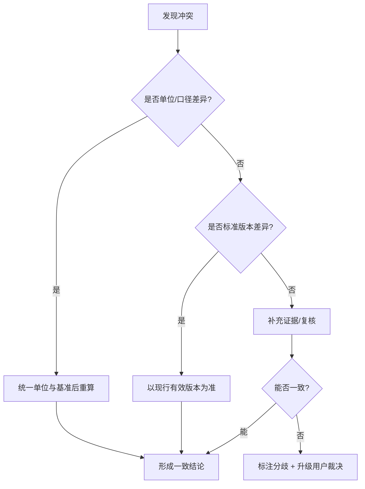

# 汇总质检与输出规范

> 整理范围：多专家结果的汇总结构、冲突检测与消解、质量校验清单、不确定性表达、三类交付物模板（执行摘要/综合报告/任务分派单）、复盘与知识沉淀。
> 主要依据：`../agent.md` 的汇总校验与输出规范、`../skills/orchestration/SKILL.md` 的质检清单与冲突处理；多智能体结果融合（result aggregation）、质量保证（QA）与文献不确定度表达的通用实践。
> 说明：本规范是**协调专家的把关依据**，用于统一各子任务产出的口径与格式。涉及标准限量、检测方法、法规条文，一律"以现行有效版本正文为准"，不得凭条目臆造。

---

## 一、多专家结果汇总结构

最终交付物按以下**固定顺序**组织，保证可读、可追溯：

| 顺序 | 模块 | 内容 | 来源 |
|---|---|---|---|
| 1 | 执行摘要 | 目标、结论、关键数据、分工、交付物、风险与待办 | 协调专家 |
| 2 | 分工说明 | 每个子任务的责任专家、输入、产出 | 协调专家 |
| 3 | 主体 | 按模块或流程展开的实质性内容 | 各领域专家 |
| 4 | 结论 | 综合各专家结论形成的一致结论 | 协调专家 + 领域专家 |
| 5 | 风险与待办 | 不确定性、未决事项、后续动作 | 协调专家 |
| 6 | 来源标注 | 每个结论对应的专家/依据/标准版本 | 各领域专家 |

### 1.1 汇总结构图

```text
┌─────────────────────────────┐
│ 1 执行摘要（一页内可读）      │
├─────────────────────────────┤
│ 2 分工说明（谁做了什么）      │
├─────────────────────────────┤
│ 3 主体（分模块组织）          │
│   ├─ 模块A ← 专家X           │
│   ├─ 模块B ← 专家Y           │
│   └─ 模块C ← 专家Z           │
├─────────────────────────────┤
│ 4 结论（一致结论+分歧标注）   │
├─────────────────────────────┤
│ 5 风险与待办（含待核实）      │
├─────────────────────────────┤
│ 6 来源标注（可追溯）          │
└─────────────────────────────┘
```

### 1.2 来源标注规则

- 每条关键结论后标注：`来源：<专家/文件>；依据：<标准号/文献；版本>`。
- 数据标注口径：统计期、基准（干基/湿基）、单位、样本量。
- 无法追溯来源的结论**不得进入正文**，只能列入"待核实"。

---

## 二、冲突检测与消解流程

### 2.1 常见冲突类型

| 类型 | 表现 | 高发环节 |
|---|---|---|
| 数值冲突 | 同一指标数值不一致 | 检测 vs 加工、营养 vs 安全 |
| 单位/口径冲突 | 单位或基准不同导致"假冲突" | 跨专家汇总 |
| 标准版本冲突 | 引用不同年份标准 | 全部 |
| 结论冲突 | 一方判"合规"、一方判"超标" | 安全 vs 加工/营养 |
| 边界越权 | 专家给出非其领域结论 | 路由错误 |

### 2.2 消解流程



### 2.3 消解原则

1. **先归因、后裁决**：优先排查单位、口径、基准、版本等"技术性假冲突"。
2. **不取平均**：专家结论冲突时严禁自行取平均值或折中数值。
3. **证据优先**：以可追溯的原始数据、现行标准与验证结果为准。
4. **保留分歧**：无法消解时，在结论中并列陈述双方观点、证据与影响，并升级用户。
5. **回环有限**：补充证据的回环须设上限（默认 2 轮），达上限即升级。

---

## 三、质量校验清单

交付前逐项打勾；任一项不通过则返工或标注待核实。

- [ ] **事实一致**：同一数据在不同模块数值一致；无自相矛盾。
- [ ] **单位统一**：单位制、基准、统计期、有效数字统一。
- [ ] **标准现行**：引用的标准/法规标注标准号与年份，且为现行有效版本。
- [ ] **领域边界**：未出现越权结论（如检测专家下安全定性、加工专家做营养结论）。
- [ ] **完整可追溯**：所有子任务均有产出与验收；结论可追溯至专家/依据。
- [ ] **合规性**：涉及限量、方法、禁限用清单处已声明"以现行标准正文为准"。
- [ ] **不确定性**：数据不足处已标注"待核实"，未臆造。
- [ ] **格式规范**：符合目标文档规范（模板、字体、层级、图表编号）。
- [ ] **受众适配**：详略与术语符合受众（政府/企业/公众/专家）。
- [ ] **无敏感与保密问题**：未泄露未授权数据或个人信息。

### 3.1 校验记录模板

```text
【质检记录】
交付物：<名称>            校验人：协调专家      日期：<YYYY-MM-DD>
检查项            结论     备注
事实一致          ✅/⚠️/❌
单位统一          ✅/⚠️/❌
标准现行          ✅/⚠️/❌   <列标准号>
领域边界          ✅/⚠️/❌
完整可追溯        ✅/⚠️/❌
合规性            ✅/⚠️/❌
不确定性          ✅/⚠️/❌
格式规范          ✅/⚠️/❌
结论：通过 / 有条件通过（附待办） / 返工
```

---

## 四、不确定性表达（待核实标注规范）

### 4.1 分级标注

| 级别 | 标注 | 含义 | 处理 |
|---|---|---|---|
| 确认 | （无标注） | 有权威来源/实测支撑 | 可进结论 |
| 较可靠 | `【待复核】` | 来源可靠但版本/条件需核 | 附注后谨慎使用 |
| 待核实 | `【待核实】` | 缺关键依据或来源不明 | 不得作为结论依据 |
| 存疑/冲突 | `【存疑】` | 数据冲突或明显异常 | 需消解或升级 |

### 4.2 表达用语

- **推荐**："在 X 条件下，Y 约为 Z（范围），来源：……；实际取值须以小试/现行标准复核。"
- **避免**："肯定""必然""据经验"等无依据的绝对化表述。
- **冲突时**：并列陈述——"专家甲认为……（依据……）；专家乙认为……（依据……）；尚需……核实。"
- **缺数据时**：明确写出"缺 X 数据，无法判定 Y"，并列入待办。

### 4.3 待核实清单汇总

交付物末尾集中列出全部 `【待核实】`/`【存疑】` 项，按编号列出，便于用户集中决策。

---

## 五、交付物模板

### 5.1 执行摘要模板

```markdown
## 执行摘要
- **目标**：<一句话交付目标>
- **结论**：<1-3 条核心结论，含关键数据与单位>
- **分工**：
  - <子任务 T1> → <专家>
  - <子任务 T2> → <专家>
- **交付物**：<清单>
- **风险与待办**：<未决事项、待核实项、下一步>
```

### 5.2 综合报告模板

```markdown
# <报告标题>

> 编制：协调专家（多专家协同）  日期：<YYYY-MM-DD>
> 依据：<主要依据与版本>

## 一、执行摘要
（见 5.1）

## 二、背景与目标
## 三、分工说明
| 子任务 | 责任专家 | 输入 | 产出 |
|---|---|---|---|

## 四、主体内容
### 4.1 <模块 A>（来源：<专家>）
### 4.2 <模块 B>（来源：<专家>）

## 五、结论
## 六、风险与待办
| 编号 | 事项 | 类型（风险/待核实/待决策） | 建议 |
|---|---|---|---|

## 七、来源标注
- <结论> —— 来源：<专家/文件>；依据：<标准号/文献；版本>
```

### 5.3 任务分派单模板（交接协议落地）

```markdown
## 任务分派单
- **任务 ID**：<T1>
- **责任专家**：<agent 名>
- **任务目标**：<可验收目标>
- **背景**：<项目/用途/受众>
- **已知数据**：<上游数据、样品、文献>
- **约束条件**：<法规/成本/时间/地区/安全>
- **输出格式**：<格式/结构/篇幅/单位制>
- **上游结论**：<串行时前序结论摘要>
- **验收标准**：<合格判据>
- **时限**：<YYYY-MM-DD>
```

> 任务分派单字段与《编排模式与路由.md》第五节一致，是"交接协议"的操作化表单。

---

## 六、复盘与知识沉淀

### 6.1 复盘触发

- 大型跨专家项目交付后；
- 出现结论冲突、返工或用户重大反馈后；
- 形成可复用的新流程或新模板后。

### 6.2 复盘内容

| 维度 | 问题 | 产出 |
|---|---|---|
| 目标 | 是否一次澄清到位？ | 澄清清单改进项 |
| 拆解 | 子任务是否 MECE？ | 拆解模板修正 |
| 路由 | 有无误派/漏派？ | 路由关键词补充 |
| 交接 | 有无重复提问、信息丢失？ | 分派单字段完善 |
| 质检 | 是否发现遗漏的校验项？ | 质检清单增补 |
| 冲突 | 冲突根因是什么？ | 消解规则补充 |

### 6.3 知识沉淀路径

将复盘得到的**可复用结论**登记到相应位置（遵循各专家 `references/README.md` 的收录约定）：

- 路由/编排类结论 → 本目录 `编排模式与路由.md` 或 `跨专家工作流与场景.md`。
- 领域知识类结论 → 对应领域专家 `references/`（如 `../../发酵专家/references/README.md`）。
- 模板与表单 → 本目录 `../templates/`（若存在）或本文件第五节。
- 新增文件须在目录 `README.md` 登记（但**不得修改本任务范围外的 README.md / SKILL.md / agent.md**）。

### 6.4 沉淀登记表（示例）

| 日期 | 来源项目 | 可复用结论 | 登记位置 | 维护人 |
|---|---|---|---|---|
| YYYY-MM-DD | <项目> | <结论> | <文件> | 协调专家 |

---

## 来源与待核实

- 一级（权威）：本项目 `../agent.md`、`../skills/orchestration/SKILL.md`；各领域专家 `references/README.md` 的收录约定。
- 二级（参考）：质量管理（QA/QC）、结果融合与不确定度表达的通用工程实践；文献"待核实/待复核"标注惯例。
- **待核实清单**：
  1. 质检清单是否需按行业细分（食品/农业/检测）增补专项项。
  2. 冲突消解回环默认 2 轮是否为项目可接受值。
  3. 不确定性分级术语（待复核/待核实/存疑）是否符合团队既有习惯。
  4. `../templates/` 目录现有模板清单与命名，需现场核对后决定登记位置。
  5. 知识沉淀是否需建立独立"复盘日志"文件（需先确认是否在授权范围内）。
  6. 交付物模板的字体/排版规范应转交文档格式化专家按其模板执行。
