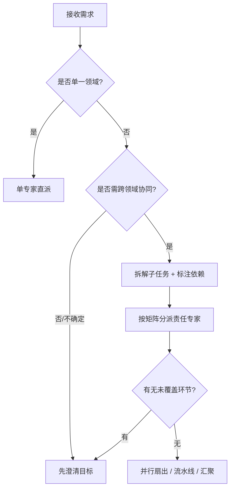

# 编排模式与路由

> 整理范围：任务分类与专家路由矩阵、任务拆解方法（MECE）、依赖类型、五种编排模式、交接协议字段、上下文与信息保真、升级用户裁决的触发条件。
> 主要依据：`../agent.md` 与 `../skills/orchestration/SKILL.md` 已定义的路由表与流程；多智能体协作（multi-agent collaboration）、任务分解（task decomposition）与工作流编排（workflow orchestration）的通用工程实践。
> 说明：本文件只描述**如何组织专家协同**，不描述各专家的具体专业结论；路由关键词为检索线索，最终归属由协调专家判断。文中标注「待核实」处见文末清单。

---

## 一、任务分类与专家路由矩阵

### 1.1 专家清单与职责边界

| Agent | 中文名 | 职责关键词（路由线索） | 不负责（边界） |
|---|---|---|---|
| `planting-expert` | 种植专家 | 栽培、田间管理、土肥水、植保、生长模型、品质与逆境 | 品种选育、加工工艺、食品安全判定 |
| `breeding-expert` | 育种专家 | 种质资源、引种、选择/杂交/诱变、分子育种、品种审定、制种、品种权 | 田间栽培、育苗、检测方法 |
| `nursery-expert` | 育苗专家 | 播种催芽、基质与穴盘、嫁接/扦插、组培脱毒、工厂化育苗、壮苗、移栽成活 | 大田栽培、品种权 |
| `fermentation-expert` | 发酵专家 | 菌种、发酵工艺、动力学建模、下游纯化、膜分离 | 食品配方与产线、营养评价 |
| `food-processing-expert` | 食品加工专家 | 配方、单元操作、中试放大、杀菌、货架期、产线 | 安全风险评估、营养测算 |
| `food-safety-expert` | 食品安全专家 | 风险评估、风险排序、限量合规、残留/毒素/添加剂、HACCP 危害分析 | 工艺参数设计、营养配餐 |
| `nutrition-expert` | 营养专家 | 能量与营养素测算、DRIs/NRV、配餐/食谱、营养标签 | 工艺设计、安全限量判定 |
| `detection-expert` | 检测专家 | 检测方法、样品前处理、色谱/质谱/光谱/免疫/快检、方法验证、质量体系、能力评价 | 风险处置决策、工艺优化 |
| `document-expert` | 文档专家 | PPT/Word 生成、排版、模板套用（公文/报告/申报书）、汇报材料 | 任何专业结论的产生 |

> 边界原则：**谁对结论负责，谁出具结论**。协调专家不得替领域专家做专业判断（见 `../agent.md` 协作原则）。

### 1.2 路由矩阵（关键词 → 专家）

| 关键词簇 | 首选专家 | 常见协同专家 |
|---|---|---|
| 栽培/田间/土肥水/植保/生长模型/逆境 | 种植专家 | 育苗、育种、检测 |
| 种质/引种/杂交/分子育种/品种审定/制种/品种权 | 育种专家 | 育苗、种植、检测 |
| 育苗/催芽/基质/穴盘/嫁接/扦插/组培/脱毒/壮苗/移栽成活 | 育苗专家 | 育种、种植 |
| 菌种/发酵/酿造/代谢/纯化/膜分离 | 发酵专家 | 食品加工、食品安全、检测 |
| 配方/工艺/中试/杀菌/货架期/产线 | 食品加工专家 | 发酵、食品安全、营养、检测 |
| 风险/限量/残留/毒素/添加剂/超标/HACCP 危害 | 食品安全专家 | 食品加工、检测、营养 |
| 能量/营养素/配餐/食谱/DRIs/NRV/营养标签 | 营养专家 | 食品加工、食品安全 |
| 检测/方法/前处理/色谱/质谱/仪器/验证/质量体系/能力评价 | 检测专家 | 食品安全、食品加工 |
| PPT/Word/报告/排版/模板/汇报 | 文档专家 | 上述任一（提供内容） |

### 1.3 路由判定流程



> 模糊需求处理：**先做最少必要追问**（交付物、受众、期限、约束、验收标准），再路由，避免"猜领域"。

---

## 二、任务拆解方法（目标 → 子任务 → 依赖 → 责任专家）

### 2.1 MECE 原则

- **MECE（Mutually Exclusive, Collectively Exhaustive，相互独立、完全穷尽）**：子任务之间不重叠、合起来覆盖全部交付需求。
- 反例（非 MECE）：既派"食品安全专家做风险评估"又派"检测专家判定是否超标"——结论重叠易冲突；或漏掉"营养标签"环节——不穷尽。

### 2.2 拆解六步法

| 步骤 | 动作 | 产出 |
|---|---|---|
| 1 明确交付物 | 与用户确认最终格式与用途 | 交付物定义（报告/PPT/数据集/方案） |
| 2 识别构成 | 按"内容维度"或"流程阶段"分解 | 一级模块 |
| 3 分解子任务 | 每个子任务须**可独立交付、可验收** | 子任务清单 |
| 4 标注依赖 | 判定串行/并行/汇聚/迭代 | 依赖图 |
| 5 指派专家 | 按路由矩阵一子任务一责任专家 | 责任分配表（RACI 思路） |
| 6 定义验收 | 每个子任务给交付物与验收标准 | 验收清单 |

### 2.3 拆解模板

```text
目标：<一句话交付目标>
├─ 子任务 T1：<动词+对象+产出>      责任：<专家>  依赖：无        验收：<标准>
├─ 子任务 T2：<动词+对象+产出>      责任：<专家>  依赖：T1        验收：<标准>
├─ 子任务 T3：<动词+对象+产出>      责任：<专家>  依赖：无        验收：<标准>
└─ 子任务 T4：<汇总成稿>            责任：文档专家 依赖：T2,T3    验收：<格式+完整>
```

---

## 三、依赖类型

| 类型 | 英文 | 含义 | 图示 | 编排方式 |
|---|---|---|---|---|
| 串行 | serial / sequential | 后置任务需前置结论作为输入 | `A → B → C` | 按序发起 |
| 并行 | parallel | 任务间无数据依赖，可同时进行 | `A ∥ B ∥ C` | 同时扇出 |
| 汇聚 | convergence / fan-in | 多任务产出合并为一个交付物 | `A, B → C` | 合并至汇总/文档 |
| 迭代 | iterative | 依评审/验证结果回环修正 | `A → B → 评审 → A` | 设定回环上限 |

```text
串行： [育种] → [育苗] → [种植]
并行： [营养专家] ∥ [食品安全专家]   （同源于[食品加工]产物）
汇聚： [食品加工] + [食品安全] + [营养] → [文档格式化]
迭代： [方案] → [检测/评审] → 不符合 → 返回[方案] → …
```

> 迭代必须有**终止条件**（如"最多 2 轮回环""关键指标达标即停"），否则会无限返工。参见《汇总质检与输出规范.md》。

---

## 四、编排模式

### 4.1 单专家直派（single-agent dispatch）

- 适用：需求落在单一领域，边界清晰。
- 流程：`需求 → 1 个专家 → 汇总交付`。
- 风险：误判领域导致越权回答；须先做领域判定。

### 4.2 并行扇出-汇聚（fan-out / fan-in）

- 适用：多个无依赖子任务，可同时并行提高效率。
- 流程：`需求 → 并行派发 N 个专家 → 汇聚校验 → 交付`。
- 风险：产出口径不一致（单位、标准版本、时间范围）；见第五节。

### 4.3 流水线（pipeline）

- 适用：存在明确上下游的数据流。
- 流程：`A → B → C → 交付`，上游结论作为下游输入。
- 典型：`原料 → 加工 → 安全/营养 → 文档`（见《跨专家工作流与场景.md》）。
- 风险：上游错误向下游传播；须设**阶段验收关卡**（stage gate）。

### 4.4 层级编排（hierarchical）

- 适用：任务含子任务簇，某一专家产出还需再拆。
- 流程：协调专家 → 主责专家 → （该专家内部子步骤/辅助专家）。
- 说明：本库为**扁平路由**，层级编排体现为"协调专家→领域专家→文档专家"的三段式，不建议凭空创建新角色。

### 4.5 评审回环（review loop / reflection）

- 适用：高风险或合规敏感交付（食品安全、标准符合性、申报材料）。
- 流程：`初稿 → 领域专家复核 → 质检 → （不符则返工）→ 定稿`。
- 角色：初稿产出专家 + 复核专家 + 协调专家（质检）。
- 风险：回环失控；须限定轮次与退出条件。

### 4.6 模式选择速查

| 条件 | 推荐模式 |
|---|---|
| 单一领域、边界清晰 | 单专家直派 |
| 多领域、无相互依赖 | 并行扇出-汇聚 |
| 有明确前后数据依赖 | 流水线 |
| 高风险/合规/申报 | 评审回环（叠加流水线） |
| 子任务需再分解 | 层级编排 |

---

## 五、交接协议字段（传给子专家）

向每个专家发起任务时，必须携带以下字段（缺项须显式标注"未知/待补充"，不得省略）：

| 字段 | 内容 | 作用 |
|---|---|---|
| 任务 ID | 唯一标识（如 T2） | 便于追溯与回填 |
| 任务目标 | 一句话可验收目标 | 防止偏题 |
| 背景 | 项目背景、用途、受众 | 决定详略与口径 |
| 已知数据 | 上游已有数据、文献、样品信息 | **避免重复提问** |
| 约束条件 | 法规、成本、时间、地区、设备、安全 | 收窄可行解 |
| 输出格式 | 格式、结构、篇幅、语言、单位制 | 保证可汇总 |
| 上游结论 | 串行时前序专家结论摘要 | 保证信息连续 |
| 验收标准 | 明确的合格判据 | 可判定通过/返工 |
| 责任人/时限 | 责任专家、交付时间 | 进度管理 |

> 交接协议字段与 `../skills/orchestration/SKILL.md` 一致，本表为**结构化展开**，不得与 SKILL 冲突。

---

## 六、上下文与信息保真

### 6.1 单一事实来源（SSOT, Single Source of Truth）

- 同一数据只在一个地方定义（如"年产量 500 t"），子任务引用而非各自录入。
- 汇总阶段以 SSOT 为准核对各处引用，发现不一致即回溯。

### 6.2 统一单位与口径

| 维度 | 统一要求 | 示例 |
|---|---|---|
| 单位制 | 优先法定计量单位（SI） | 质量 kg、体积 L、浓度 mg/kg |
| 数值口径 | 明确基准（干基/湿基、以谁计） | "以干基计""以 100 g 计" |
| 时间口径 | 统一统计期与截止日 | "2026 年度""截至 2026-09-30" |
| 标准版本 | 标注标准号+年份+现行状态 | "GB ××××—20××（现行）" |
| 术语 | 首次出现附英文，建立术语表 | 见各 references 约定 |

### 6.3 避免重复提问

- 交接时**尽量一次性**传齐已知数据与约束；已知项不得再向用户重复索取。
- 维护"已确认信息表"，新子任务从该表取上下文，而非重新采集。

### 6.4 信息压缩与无损传递

- 上游给下游的是**结论 + 关键依据 + 数据血缘**，不是全部原始记录。
- 原始数据如需保留，作为附件随交接传递，并在汇总时标注引用位置。

---

## 七、何时升级给用户裁决

出现以下情况，协调专家应**暂停编排、提请用户裁决**，不得自行取平均或臆断：

1. **专家结论冲突且证据相当**：补充证据复核后仍不一致（见《汇总质检与输出规范.md》冲突消解）。
2. **关键输入缺失**：缺样品、缺原始数据、缺标准正文，且无法通过检索补齐。
3. **合规/安全高风险**：涉及食品安全事件处置、超标判定、召回、法律责任的取向选择。
4. **需授权或资源决策**：涉及预算、产能、设备采购、时间排期等非技术权衡。
5. **超出全部专家职责范围**：无专家可覆盖的领域，不得硬套。
6. **目标本身矛盾**：如"低成本"与"最高标准"不可兼得，需用户排定优先级。
7. **回环达上限仍不达标**：迭代多轮仍无合格产出。

> 升级时应以结构化方式提出：**分歧点 + 各方证据 + 影响 + 待用户选择项**，并给出默认建议（若有）。

---

## 来源与待核实

- 一级（权威）：本项目 `../agent.md`、`../skills/orchestration/SKILL.md` 的路由表与流程定义。
- 二级（参考）：多智能体系统（MAS）、任务分解、工作流编排的通用工程实践与公开综述；仅作方法参考。
- **待核实清单**：
  1. 需求方所述"10 个领域专家"与实际仓库定义（`../.opencode/agent/` 与 `../agent.md` 共 **9 个**：种植/育种/育苗/发酵/食品加工/食品安全/营养/检测分析/文档格式化）不一致，请确认是否还有第 10 位未登记专家。
  2. 各专家路由关键词是否需补充同义词/别名（如方言、行业简称）。
  3. 迭代回环的默认轮次上限（暂拟 2 轮）是否符合项目习惯。
  4. 是否需要引入 RACI（负责/批准/咨询/知会）矩阵作为标准责任分配工具。
  5. 升级裁决的响应时限与默认处理策略需与用户约定。
