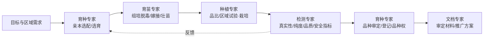
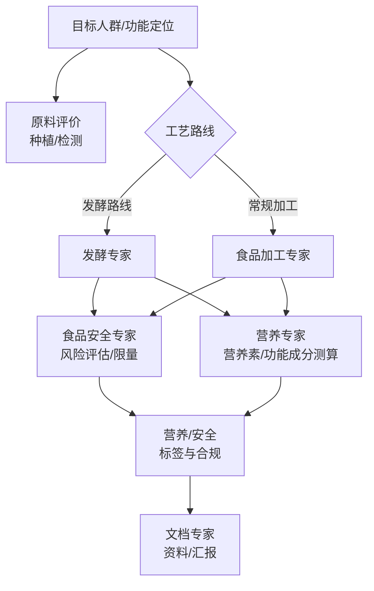
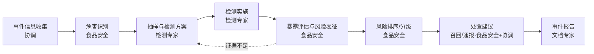
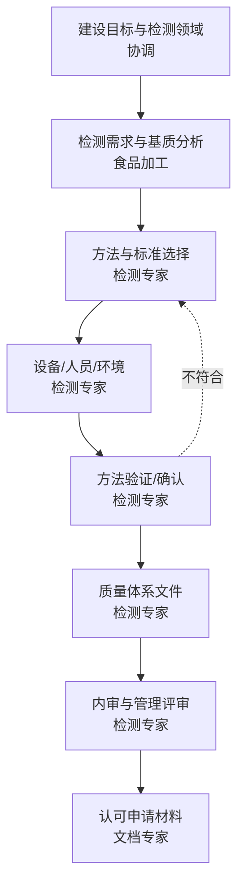
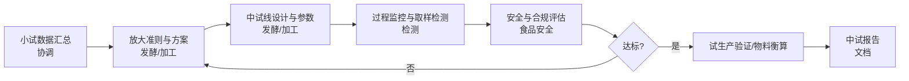
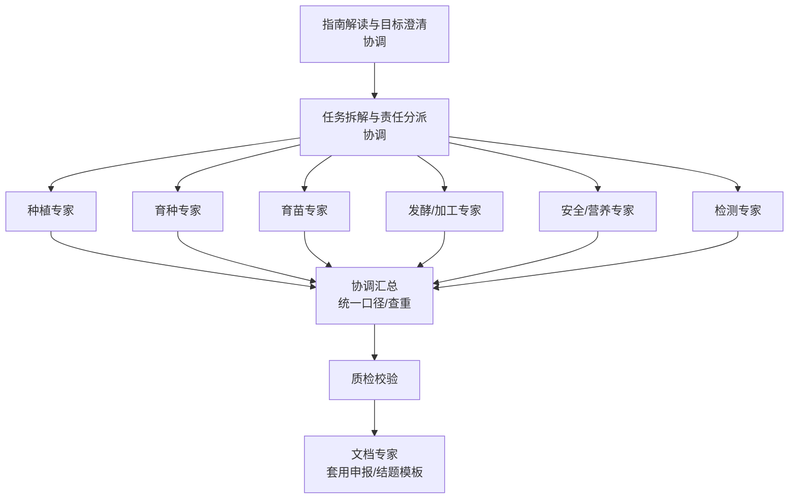

# 跨专家工作流与场景

> 整理范围：6 个典型端到端（end-to-end）工作流——农作物新品种、功能食品、食品安全事件、检测能力建设、中试放大、政府项目申报；每个工作流含流程图、分步责任、输入输出与风险点。
> 主要依据：`../agent.md` 与 `../skills/orchestration/SKILL.md` 的专家职责与路由；`../references/编排模式与路由.md` 的编排模式与依赖类型；本库九个专家的领域描述。
> 说明：下图中的阶段划分与顺序为**通用编排参考**，实际项目须按用户约束（品种、产品、法规、时间）调整。涉及限量值、检测方法、标准版本号一律"以现行标准正文为准"。文末为待核实清单。

---

## 场景 A：农作物新品种（育种 → 育苗 → 种植 → 检测 → 审定/推广）

| 步 | 任务 | 负责专家 | 输入 | 输出 |
|---|---|---|---|---|
| A1 | 明确育种目标、适种区域、用途 | 协调专家 | 用户需求 | 目标说明书（含验收标准） |
| A2 | 种质资源评价、亲本选配、选择/杂交/分子育种方案 | 育种专家 | 目标、种质清单 | 育种方案、世代材料 |
| A3 | 脱毒/组培扩繁、嫁接或穴盘育苗、壮苗 | 育苗专家 | 优良单株/种子 | 健康种苗、育苗记录 |
| A4 | 品种比较试验、区域试验、水肥与植保管理 | 种植专家 | 种苗、试验设计 | 田间数据、生长表现 |
| A5 | 真实性/纯度、品质与安全指标检测（方法验证） | 检测专家 | 样品、检测方案 | 检测报告（含不确定度） |
| A6 | 品种审定/登记、DUS 相关测试材料、品种权申请 | 育种专家 | 试验与检测数据 | 审定/登记/权属材料 |
| A7 | 编制审定申报书、品种推广材料 | 文档专家 | A6 内容 | 申报书/推广 PPT |

**风险点**
- 检测环节若缺少方法验证或对照，纯度/真实性结论不可靠 → 要求检测专家给出方法依据与检出限。
- 育种目标与区域生态不匹配 → A1 必须澄清适种区域与用途。
- 审定标准与当前法规版本不符 → A6 须"以现行品种审定办法/标准为准"。
- 检测结果异常时需回环至 A2/A4，需设回环上限（见《编排模式与路由.md》）。

---

## 场景 B：功能食品（原料 → 发酵/加工 → 安全 → 营养 → 标签 → 上市）

| 步 | 任务 | 负责专家 | 输入 | 输出 |
|---|---|---|---|---|
| B1 | 目标人群、功能定位、剂型与食用方式 | 协调专家 | 用户需求 | 产品定义 |
| B2 | 原料品质、农残/污染物初筛 | 种植专家 / 检测专家 | 原料信息 | 原料评价、检测方案 |
| B3 | 发酵工艺（菌种、参数、下游）或加工工艺（配方、单元操作、杀菌、货架期） | 发酵专家 / 食品加工专家 | 原料、产品定义 | 工艺方案、样品 |
| B4 | 风险评估、限量合规、HACCP 危害分析 | 食品安全专家 | 工艺、配方、样品 | 风险与合规结论 |
| B5 | 能量、营养素与功能成分测算、DRIs/NRV | 营养专家 | 配方、成品数据 | 营养测算表 |
| B6 | 营养标签、成分表、营养/功能声称合规 | 营养专家 / 食品安全专家 | B4、B5 | 标签文案（待核） |
| B7 | 上市资料、说明书、汇报材料 | 文档专家 | B6 等 | 文档/PPT |

**风险点**
- "功能声称"属合规高风险 → 须由食品安全/营养专家核验，禁止臆造。
- 发酵与加工两条路线可并行探索，但**同一产品只能取一条主路线交付**，避免结论打架。
- 营养素数据来源不一（成分表/检测/数据库）→ 统一口径与来源标注。
- 标签数值须以成品实测与现行标准为准，"参考值"不得直接上市。

---

## 场景 C：食品安全事件风险评估与处置

| 步 | 任务 | 负责专家 | 输入 | 输出 |
|---|---|---|---|---|
| C1 | 收集事件信息、明确检测与处置目标 | 协调专家 | 事件线索 | 事件任务书 |
| C2 | 危害识别、危害分析 | 食品安全专家 | 事件信息 | 危害清单 |
| C3 | 确定抽样方案与检测项目/方法 | 检测专家 | 危害清单 | 检测方案 |
| C4 | 样品前处理与仪器分析、方法验证 | 检测专家 | 样品、方案 | 检测报告 |
| C5 | 剂量-反应、暴露评估、风险表征 | 食品安全专家 | C4 数据 | 风险结论 |
| C6 | 风险排序/分级 | 食品安全专家 | C5 | 风险等级 |
| C7 | 处置建议（召回/通报/控制措施） | 食品安全专家 + 协调专家 | C6 | 处置方案 |
| C8 | 事件调查报告、通报材料 | 文档专家 | C7 | 报告/通报 |

**风险点**
- 事件处置涉法律责任 → 协调专家须及时**升级用户裁决**（见《编排模式与路由.md》第七节）。
- 检测证据不足或方法不适用 → 回环 C3/C4，不得用不充分证据下定性结论。
- 时限压力下易越权 → 专业判定必须由食品安全/检测专家给出，协调专家只做组织。
- 报告措辞敏感 → 由食品安全专家审读后再交文档专家定稿。

---

## 场景 D：检测能力建设与 CNAS/CMA 认可

| 步 | 任务 | 负责专家 | 输入 | 输出 |
|---|---|---|---|---|
| D1 | 明确认可类型、检测领域与目标 | 协调专家 | 用户需求 | 建设目标书 |
| D2 | 明确待检样品/基质与产品特性 | 食品加工专家 | 产品/工艺信息 | 基质与项目清单 |
| D3 | 选择检测方法与标准、判定依据 | 检测专家 | D2、法规 | 方法清单 |
| D4 | 设备配置、人员能力、设施环境规划 | 检测专家 | 方法清单 | 资源配置方案 |
| D5 | 方法验证/确认、质控与不确定度 | 检测专家 | 方法、样品 | 验证报告 |
| D6 | 质量体系文件（质量手册/程序文件/记录） | 检测专家 | 认可准则 | 体系文件 |
| D7 | 内审、管理评审、能力验证 | 检测专家 | 体系文件 | 内审/评审记录 |
| D8 | 申请材料整理与排版 | 文档专家 | D7 | 申报材料 |

**风险点**
- 认可准则版本更新频繁 → D5/D6 须"以现行 CNAS/CMA 准则与标准为准"。
- 方法验证不充分 → 不得宣称能力已具备。
- 食品加工专家只提供基质/工艺背景，**不替代**检测专家做方法判定。
- 体系文件与实际运行脱节 → 内审回环至 D6。

---

## 场景 E：中试基地工艺放大与合规

| 步 | 任务 | 负责专家 | 输入 | 输出 |
|---|---|---|---|---|
| E1 | 汇总小试数据、明确放大目标 | 协调专家 | 小试记录 | 放大任务书 |
| E2 | 选择放大准则（恒 kLa/P/V/叶端线速度等）与方案 | 发酵专家 / 食品加工专家 | 小试数据 | 放大方案 |
| E3 | 中试线设计、工艺参数与设备选型 | 发酵专家 / 食品加工专家 | 方案 | 中试工艺卡 |
| E4 | 过程监控、取样与前处理、分析 | 检测专家 | 工艺卡、样品 | 过程数据、检测报告 |
| E5 | 安全评估、限量与 HACCP/合规校核 | 食品安全专家 | 工艺、成品数据 | 合规结论 |
| E6 | 达标判定与试生产验证、物料/能量衡算 | 发酵/加工专家 | E4、E5 | 验证报告 |
| E7 | 中试总结报告 | 文档专家 | E6 | 中试报告 |

**风险点**
- 放大非线性误差（传质/传热/剪切）→ 不得直接线性外推，须以中试实测校核。
- 合规未同步 → 先做安全评估再放大，避免"先建后改"。
- 检测数据不足以支撑达标判定 → 回环 E2/E4。
- 中试废弃物/尾水处置需在 E5 一并考虑（合规与环境）。

---

## 场景 F：政府项目申报 / 结题报告（多专家数据汇总 → 文档格式化）

| 步 | 任务 | 负责专家 | 输入 | 输出 |
|---|---|---|---|---|
| F1 | 解读申报指南/结题要求、明确指标 | 协调专家 | 指南文件 | 指标分解表 |
| F2 | 拆解为技术模块并分派 | 协调专家 | 指标表 | 任务分派单 |
| F3 | 各技术模块内容与数据 | 对应领域专家 | 分派单 | 模块材料 |
| F4 | 汇总、统一单位口径、查重与去冲突 | 协调专家 | F3 | 汇总稿 |
| F5 | 质量校验（事实/单位/标准/边界/完整） | 协调专家 | 汇总稿 | 校验记录 |
| F6 | 套用申报书/结题报告模板、排版 | 文档专家 | 汇总稿 | 交付文档 |

**风险点**
- 指标口径与指南不符 → F1 必须逐条对齐，避免答非所问。
- 各模块单位/年度/统计口径不一致 → F4 统一（见《编排模式与路由.md》第六节）。
- 数据来源不可追溯 → 每个结论标注来源专家与依据。
- 申报材料造假风险 → 只汇总各专家实际产出，不得编造数据或成果。

---

## 场景间关系与复用组件

| 复用环节 | 出现场景 | 说明 |
|---|---|---|
| 目标澄清与任务书 | A–F 全部 | 协调专家统一模板 |
| 检测方案与验证 | A、B、C、D、E、F | 检测专家 |
| 风险评估/限量合规 | B、C、E | 食品安全专家 |
| 汇总质检 | A–F 全部 | 协调专家（详见《汇总质检与输出规范.md》） |
| 文档成稿 | A–F 全部 | 文档专家 |

---

## 来源与待核实

- 一级（权威）：本项目 `../agent.md`、`../skills/orchestration/SKILL.md`；各领域专家的 references 知识文件（如 `../../发酵专家/references/`）。
- 二级（参考）：项目管理与研发流程（stage-gate、中试放大、CNAS/CMA 认可流程）的通用实践。
- **待核实清单**：
  1. 各场景的阶段划分是否符合本项目实际合作流程（如海天/宏全项目，见 `/home/caiq/project/project.md`）。
  2. 场景 A 的"品种审定/登记"与场景 D 的"CNAS/CMA"具体法规/准则名称与现行版本，须以官方平台为准。
  3. 场景 B 功能食品的"功能声称"合规要求与保健食品备案/注册路径，需以现行法规为准。
  4. 场景 E 中试放大的判据（kLa、P/V、叶端线速度）取值须按具体菌株/产品小试确定。
  5. ~~是否存在需要第 10 位专家参与的场景~~ **（2026-10-23 已澄清）**：现有 12 位领域专家，见《编排模式与路由.md》§1.1；本清单其余条目仍待核实。
  6. 各场景的回环上限与阶段验收关卡（stage gate）判据需与用户约定。
