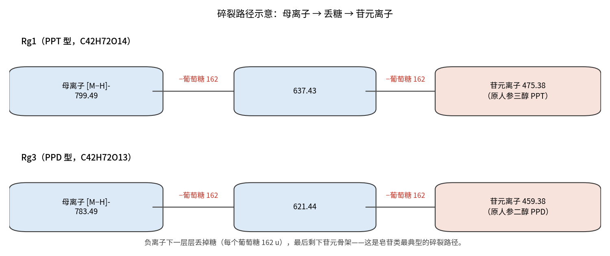
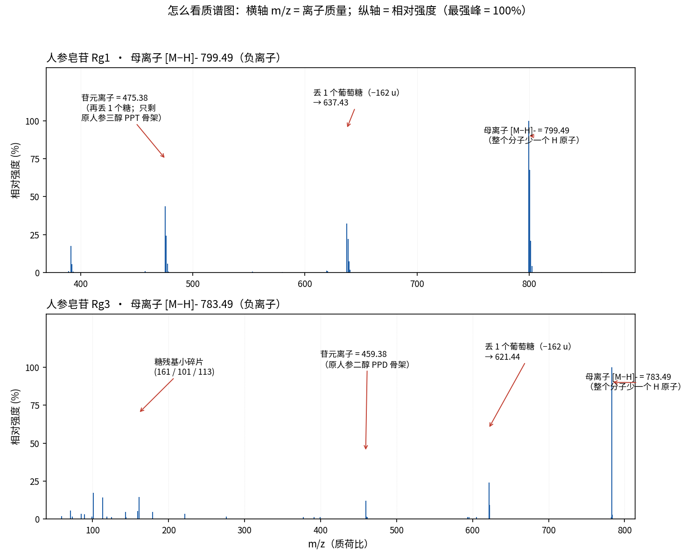
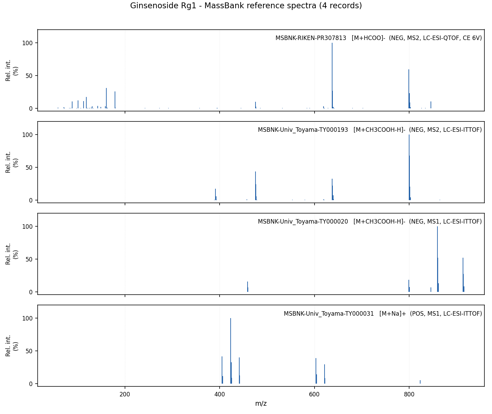
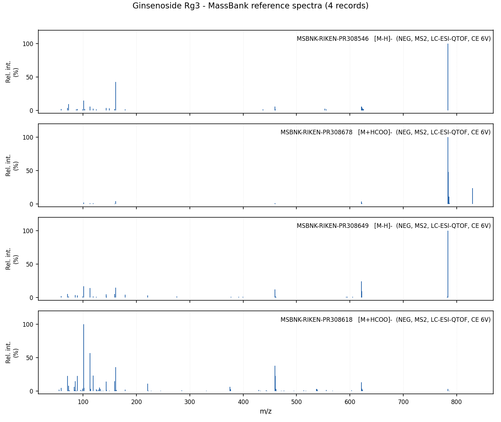

# 人参皂苷 Rg1 / Rg3 质谱图怎么看（入门讲解）

> **配套文件**（本目录下）：
> - 讲解图 `讲解_如何看质谱图.png`、`讲解_碎片路径.png`
> - 原始谱图 `Rg1_mass_spectra.png`、`Rg3_mass_spectra.png`
> - 完整峰表 `peaks_all.csv`、`MRM通道建议.md`
>
> 数据来源：**MassBank** 参考谱库（检索日 2026-10-23）｜化合物：人参皂苷 Rg1、Rg3

---

## 一、质谱图像什么？

把它想成**给分子"称重 + 排队"**：分子先带上电，再按"体重"从轻到重排好，哪种离子多、哪根线就高。

```
相对强度(%)
 100 |                     █         ← 最高的峰叫"基峰"，定为 100%
     |                  █  █
  50 |          █    █  █  █
     |      █   █    █  █  █
   0 +------█---█----█--█--█---------
          100 161  475 637 799   →  m/z（质量）
      （小碎片）（苷元）  （母离子：靠右、最大）
```

## 二、两个坐标轴

| 轴 | 含义 | 怎么理解 |
|---|---|---|
| **横轴 m/z** | 质荷比 = 离子的质量 | 这根离子有多重（单位 Da）。离子一般带 1 个电荷，所以 m/z ≈ 质量 |
| **纵轴 相对强度 (%)** | 该离子有多少 | 把最强的那根定为 100%，其余按比例画。**不用管绝对值**，只看"哪些质量的离子多" |
| **一根竖线** | 一种离子 | 每根线对应一个确定的 m/z |

## 三、一张谱图分三块看

| 位置 | 是什么 | 说明 |
|---|---|---|
| **最右边的大峰** | **母离子** | 整个分子带个电、还没碎（如 Rg1 的 799.49） |
| **中间** | **碎片离子** | 掉了 1~2 个糖（如 637.43、475.38） |
| **左下角小峰** | **糖残基** | 糖本身碎成的小片（161、179、101、113 等） |

**核心机理**：ESI 是"温柔"的电离——不把分子打碎，只让它带上电，得到右边的母离子；再给它一点能量，它就像**掰积木**一样一个个把糖掰下来（**每掰掉一个葡萄糖 = 少 162 u**），最后剩下光秃秃的骨架，叫**苷元**。



## 四、带标注的谱图



（图上半部分 = Rg1，下半部分 = Rg3；红色箭头指出了每个关键峰代表什么。）

## 五、Rg1 逐峰解读（母离子 799.49）

| 峰 m/z | 含义 | 怎么算出来的 |
|---|---|---|
| **799.49** | 完整分子（少一个氢带负电） | Rg1 分子重 800.49，丢 1 个 H |
| **637.43** | 掉 1 个葡萄糖 | 799.49 − 162（葡萄糖） |
| **475.38** | 掉光 2 个糖，剩骨架（原人参三醇 PPT） | 637.43 − 162 |
| 161 / 179 | 糖残基碎片 | 葡萄糖自身碎裂 |

## 六、Rg3 逐峰解读（母离子 783.49）

| 峰 m/z | 含义 | 怎么算出来的 |
|---|---|---|
| **783.49** | 完整分子（比 Rg1 少一个氧，所以轻 16） | Rg3 分子重 784.49，丢 1 个 H |
| **621.44** | 掉 1 个葡萄糖 | 783.49 − 162 |
| **459.38** | 掉光 2 个糖，剩骨架（原人参二醇 PPD） | 621.44 − 162 |
| 101 / 113 / 161 | 糖残基碎片 | 糖自身碎裂 |

## 七、Rg1 和 Rg3 差在哪里？

看两张图能直接发现：**每一步都刚好差 16。**

| 步骤 | Rg1 | Rg3 | 差值 |
|---|---|---|---|
| 母离子 | 799.49 | 783.49 | 16 |
| 掉 1 个糖 | 637.43 | 621.44 | 16 |
| 苷元 | 475.38 | 459.38 | 16 |

差的这 **16 就是一个氧原子**——Rg1 的骨架（原人参三醇 PPT）比 Rg3 的骨架（原人参二醇 PPD）多一个氧。分子式也对应：Rg1 = C42H72O14，Rg3 = C42H72O13。




## 八、几个常见疑惑

1. **为什么 799.49 旁边还有一根 800.49？**
   那是**同位素峰**。自然界的碳约 1% 是碳-13，分子里碳很多（Rg1 有 42 个碳），就有一部分分子重 1 个单位。**正常现象，不是杂质。**

2. **为什么一共给了 8 张谱？**
   因为可以做不同实验：
   - 加合物不同：有的让分子"丢 H"（[M−H]⁻），有的让它"抓一个甲酸根"（[M+HCOO]⁻）；
   - 层级不同：**MS1** 只测完整分子，**MS2** 把分子打碎后看碎片。
   同一化合物的不同实验，碎片规律是一致的。

3. **为什么有时最右边的大峰不是最高的？**
   能量高时母离子被"打光"，碎片峰反而更高（例如 Rg1 的第一张谱里，637 比 799 还高）。

## 九、这张图有什么用？

- **认人（定性）**：每种分子的碎片组合像**指纹**，拿去和谱库比对就能确认是不是 Rg1。
- **定量（做 MRM）**：选"母离子 799.49 → 碎片 475.38"这样一对离子来测——这就是 `MRM通道建议.md` 里推荐通道的由来。

---

*本讲解由质谱专家整理；谱图为 MassBank 实测参考谱，检索日 2026-10-23。*
